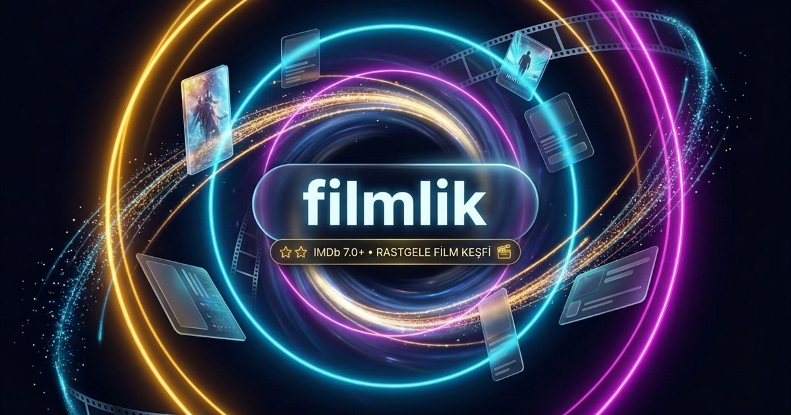

# 🎬 filmlik




**"Bu akşam ne izlesem?"** sorusunu karmaşık menüler, reklamlar ve algoritma önyargıları olmadan çözen; ultra-minimalist, görsel ve işitsel olarak şaşırtıcı bir sinema keşif uygulaması: **filmlik**.

Uygulama açıldığında kullanıcıyı hiçbir metin kalabalığı olmadan yalnızca karanlık bir uzay boşluğu, etkileşimli yıldız alanı ve merkezdeki **"FİLM SEÇ"** butonu karşılar. Butona basıldığı anda devreye giren 3 boyutlu görsel şovların ardından, **IMDb puanı 7.0 ve üzerinde olan 4.682 gerçek film** arasından tamamen rastgele bir yapım sunulur.

---

## ✨ Öne Çıkan Özellikler

### 1. 🏆 Seçkin IMDb 7.0+ Veri Havuzu (4.682 Film)
- IMDb üzerinden kazınarak oluşturulan veri seti, yalnızca **IMDb puanı 7.0 ve üzerinde (`7.0 – 9.7`)** olan nitelikli filmleri içerir.
- Her film kaydında; **Türkçe/yerel başlık**, **orijinal başlık**, **yayın yılı**, **süre (dk)**, **IMDb puanı**, **film türleri**, **konu özeti**, **yönetmen**, **başrol oyuncuları**, **yüksek çözünürlüklü afiş** ve doğrudan **IMDb bağlantı kimliği (`tt...`)** yer alır.

### 2. 🎲 %100 Adil, Kriptografik Rastgelelik
- Standart `Math.random()` yerine tarayıcının kriptografik rastgele sayı üreteci (`window.crypto.getRandomValues`) ve *rejection sampling* (modulo sapmasını sıfırlayan örnekleme) kullanılır.
- Seçilen havuz içerisindeki her filmin önerilme olasılığı matematiksel olarak birebir eşittir.

### 3. 🎭 İsteğe Bağlı Tür ve Yıl Aralığı Filtreleme (1916 – 2026)
- **Tür Seçimi (22 Kategori)**: Kullanıcı dilerse **"Tüm Türler"** seçeneğiyle tamamen sürpriz bir film çekebilir veya aşağıdaki 22 kategoriden birini seçerek yalnızca o türdeki `7.0+` IMDb puanlı filmler arasından seçim yapabilir:
  > *Aksiyon, Macera, Animasyon, Biyografi, Komedi, Suç, Belgesel, Dram, Aile, Fantastik, Kara Film (Noir), Tarih, Korku, Müzik, Müzikal, Gizem, Romantik, Bilim Kurgu, Spor, Gerilim, Savaş, Western.*
- **Yıl Aralığı Filtresi (`1916 – 2026`)**: Başlangıç ve bitiş yılı seçicileriyle (örneğin `1950 – 2026`, `1990 – 2010` veya `2020 – 2026`) yalnızca istenen dönemdeki filmler arasından öneri alınabilir.

### 4. ⚡ Butona Basıldığında Devreye Giren 3 Farklı Görsel Şov
Her seçimde arka plandaki 3D yıldız alanı hiper-hıza (*warp speed*) geçer ve aşağıdaki üç sinematik sahneden biri sırayla çalışır:
- **🌀 3D Selüloid Tüneli (Vortex)**: Seçilen türe ait gerçek film afişleri 3 boyutlu perspektif tünelinde kameraya doğru uçuşur ve anamorfik lens parlamasıyla seçilen filme kilitlenir.
- **🃏 Holografik Kader Kartları (Tarot)**: 3 boyutlu uzayda 5 gizemli kader kartı dizilir, yüksek hızda dalgalanarak karışır ve merkezdeki kart 180° dönerek seçilen filmi ortaya çıkarır.
- **🧬 Kuantum Boyut Yırtılması (Rift)**: Elektromanyetik şok dalgaları ve kromatik kırılma efektleri eşliğinde afişler yüksek hızda taranarak hedef film yakalanır.

### 5. 🔊 Prosedürel Sinema Ses Motoru (`Web Audio API`)
- Hiçbir harici `.mp3` veya `.wav` dosyasına ihtiyaç duymadan, tarayıcının `AudioContext` osilatörleri ve alçak geçiren filtreleri (*biquad lowpass filter*) ile gerçek zamanlı ses sentezlenir:
  - Seçim sırasında yükselen frekanslı **35mm projektör tıkırtıları**,
  - Boyut geçişi sırasında **portal şarj frekansı**,
  - Film ekrana düştüğü anda **IMAX / THX tarzı derin armonik sinema akoru**.

### 6. 🎨 Modern Web Teknolojileri & 3D Holografik Kart
- **Dinamik OKLCH Atmosferi**: Seçilen filmin türüne göre sayfanın ışıklandırması ve vurgu renkleri (`--accent-primary`, `--accent-secondary`, `--accent-tertiary`) `oklch()` renk uzayında otomatik olarak dönüşür.
- **3D Perspektif & Holografik Yansıma**: Açılan film kartı, fare hareketine duyarlı olarak 3 boyutlu eksende eğilir (`rotateX` / `rotateY`) ve yüzeyinde dinamik ışık kırılması oluşturur.
- **Sıfır Bağımlılık (Zero-Dependency)**: Herhangi bir harici kütüphane, framework veya derleme adımı (*build step*) gerektirmez.

---

## 📂 Proje Mimari Yapısı

```text
film_oneri/
├── index.html            # Ultra-sade semantik HTML5 sahne, Open Graph ve film kartı yapısı
├── style.css             # @layer mimarisi, OKLCH renk sistemi, fizik tabanlı yay animasyonları
├── app.js                # Kriptografik rastgelelik motoru, 3D Canvas, Web Audio API sentezleyici
├── movies-data.js        # 4.682 adet IMDb 7.0+ filmin çevrimdışı/CORS-uyumlu veri paketi
├── favicon.svg           # Vektörel sekme ikonu (Favicon)
├── favicon.png           # 64x64 sekme ikonu
├── apple-touch-icon.png  # 180x180 mobil ana ekran ikonu
├── og-preview.jpg        # 1200x630 WhatsApp / Sosyal Medya bağlantı paylaşım görseli
├── .nojekyll             # GitHub Pages statik dosya sunum yapılandırması
└── README.md             # Proje dokümantasyonu
```

---

## ♿ Erişilebilirlik & Performans Standartları

- **Azaltılmış Hareket Desteği (`prefers-reduced-motion: reduce`)**: İşletim sisteminde hareket hassasiyeti ayarı açık olan kullanıcılar için yüksek hızlı animasyonlar otomatik olarak devre dışı bırakılır.
- **Arka Plan Sekme Optimizasyonu**: Sekme arka plana alındığında (`document.hidden`) 3D Canvas çizim döngüsü otomatik olarak duraklatılarak işlemci ve pil tüketimi sıfıra indirilir.
- **Klavye ve Ekran Okuyucu Uyumu**: Görünüm geçişleri (`View Transitions API`) tamamlandığında klavye odağı otomatik olarak yeni önerilen filmin başlığına yönlendirilir.
